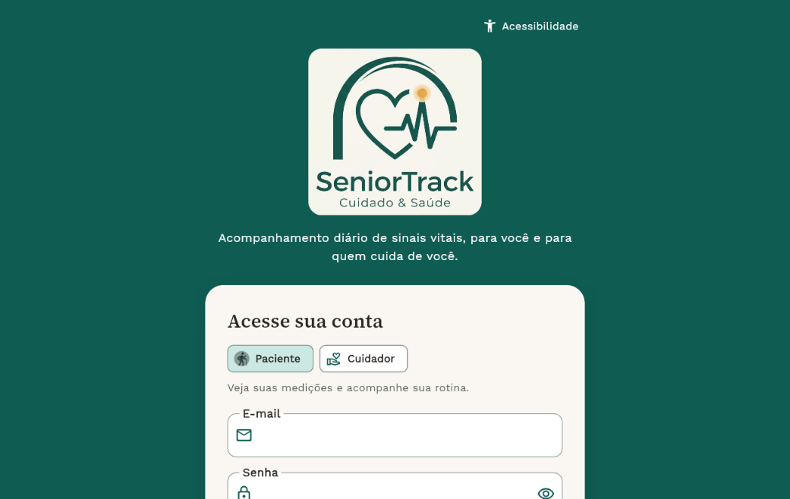
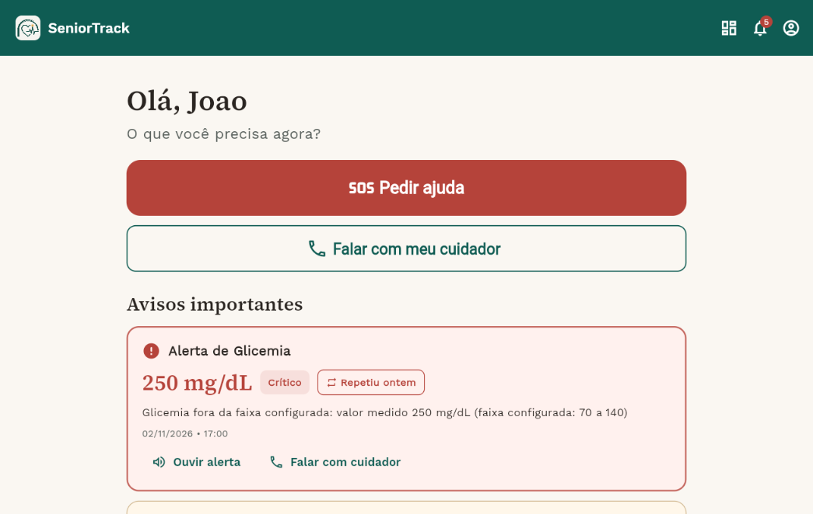
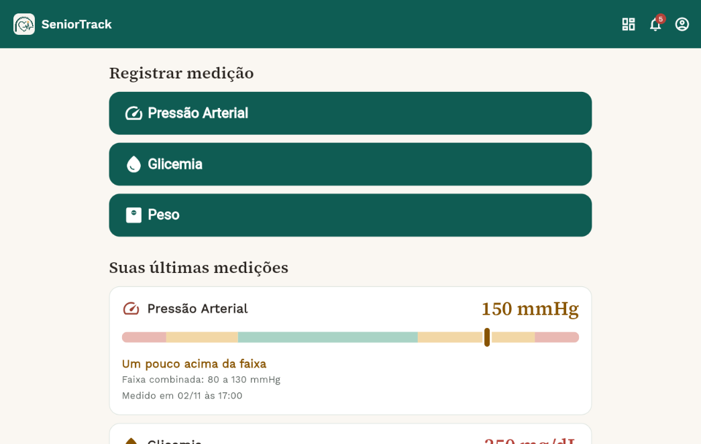
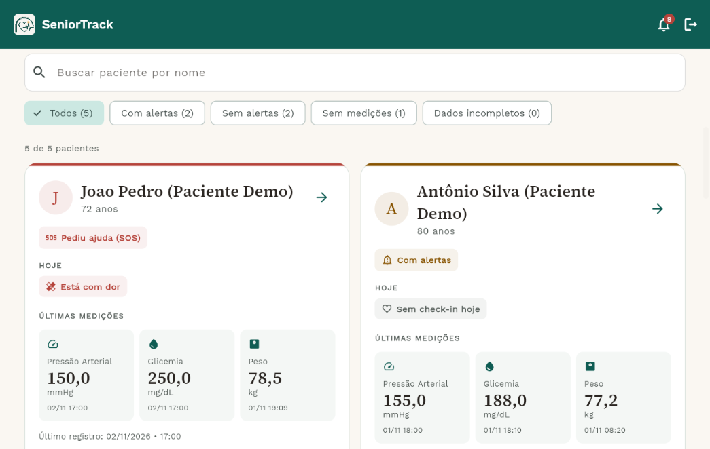

# SeniorTrack

Aplicativo de telemonitoramento de sinais vitais para idosos, desenvolvido como
Trabalho de Conclusão de Curso (TCC). O idoso registra pressão arterial,
glicemia e peso; o sistema compara cada medição com a faixa combinada para ele
e avisa o cuidador quando algo sai do normal.

| Login | Início do paciente |
|---|---|
|  |  |

| Medições do paciente | Painel do cuidador |
|---|---|
|  |  |

## O que o sistema faz

- **Paciente (idoso):** registra medições com botões grandes, vê se o valor
  está dentro da faixa por cores, ouve os avisos em voz alta, pede ajuda com o
  botão SOS, marca os remédios tomados e responde o diário de bem-estar.
- **Cuidador:** acompanha todos os pacientes vinculados num painel, recebe
  alertas classificados por gravidade, vê a evolução das medições, gerencia os
  remédios do paciente e gera relatório para consulta médica.
- **Acesso:** e-mail e senha, código por SMS/WhatsApp, login com Google e
  biometria (opções externas só ficam ativas quando configuradas).

## Estrutura do repositório

| Pasta | Conteúdo |
|---|---|
| [`telemonitoramento-backend/`](telemonitoramento-backend/) | API REST em Java 21 + Spring Boot 3, PostgreSQL, autenticação JWT |
| [`telemonitoramento-frontend/`](telemonitoramento-frontend/) | App em Flutter (web e Android) |
| [`docs/prints/`](docs/prints/) | Capturas de tela do app |

Documentação detalhada:
[backend](telemonitoramento-backend/README.md) ·
[autenticação](telemonitoramento-backend/docs/AUTENTICACAO.md) ·
[roteiro de demonstração](telemonitoramento-backend/docs/DEMONSTRACAO.md)

## Como rodar localmente

Pré-requisitos: Java 21, PostgreSQL e Flutter (Dart 3.3 ou mais novo).

1. Crie um banco vazio chamado `telemonitoramento_db` no PostgreSQL.
2. Suba o backend (as tabelas são criadas sozinhas na primeira execução):

   ```bash
   cd telemonitoramento-backend
   DB_PASSWORD=sua-senha ./mvnw spring-boot:run      # no Windows: mvnw.cmd spring-boot:run
   ```

   A API fica em `http://localhost:8080`. As demais variáveis de ambiente estão
   no [README do backend](telemonitoramento-backend/README.md).

3. Em outro terminal, rode o app:

   ```bash
   cd telemonitoramento-frontend
   flutter pub get
   flutter run -d chrome --dart-define=API_BASE_URL=http://localhost:8080
   ```

4. Crie uma conta de paciente e uma de cuidador na tela de cadastro.
